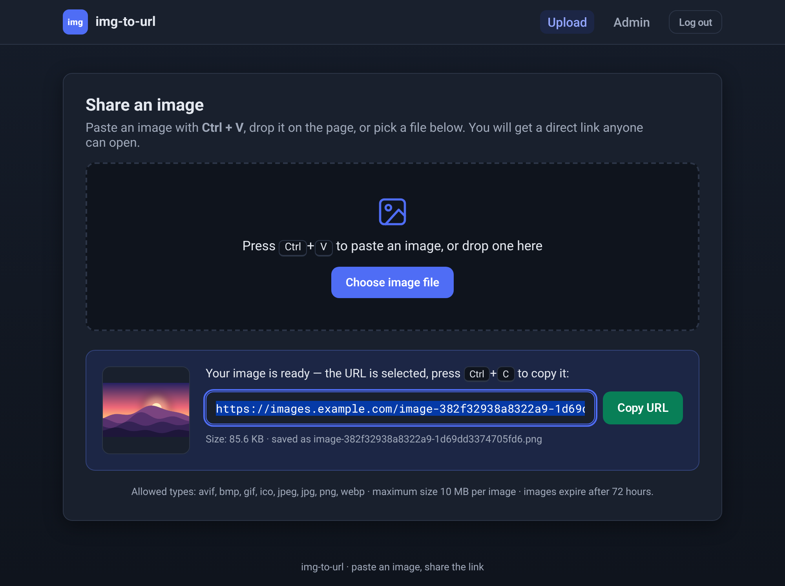

# img-to-url

Paste or upload an image, get a direct URL you can share anywhere — even in
chats and platforms that don't accept file or image attachments.



- **Paste with Ctrl+V** (clipboard), **pick a file**, or **drag & drop** — all three feed the same upload pipeline.
- **Direct links** like `https://images.example.com/image-<16 hex>-<16 hex>.png` — public, no login needed to view, auto-selected so you can just press **Ctrl+C** (plus a *Copy URL* button). Deleted or unknown links show a plain *404 Not Found* page.
- **Login-gated uploads & admin**: a single `user` account whose password comes from an environment variable; a signed session cookie keeps you logged in for 30 days. Log in at `/login` — visitors who aren't logged in get the plain *404 Not Found* page at the bare hostname instead of a redirect to the login form.
- **Admin panel**: total image count and disk usage, paginated list (10 per page, newest first) with size, date, *Copy* and *Delete* buttons, plus a *Clear all* button.
- **Dark mode** that follows each visitor's browser / OS setting automatically.
- **Expiration**: optionally delete images older than `IMG_EXPIRATION_HOURS` (a daily 05:00 cleanup job).
- **No browser caching of images by default**, so deleted images disappear right away; opt in with `IMG_CACHE_MINUTES`.
- **Light on small VMs**: one uvicorn worker by default, and parallel uploads don't block it.

Built with **Python 3.12, FastAPI, uvicorn and SQLite (WAL)**. No config files — everything arrives as environment variables.

## Run it

```bash
docker build -t img-to-url:latest .

docker run -d --name img-to-url \
  --restart unless-stopped \
  -p 8000:8000 \
  -e APP_PASSWORD='change-me' \
  -e BASE_URL='https://images.example.com' \
  -e SITE_NAME='img-to-url' \
  -e IMG_MAX_SIZE=10 \
  -e IMG_EXPIRATION_HOURS=72 \
  -e IMG_CACHE_MINUTES=0 \
  -v img-to-url-data:/data \
  img-to-url:latest
```

Then open your `BASE_URL` followed by `/login`, here
`https://images.example.com/login`, log in with `user` / your `APP_PASSWORD`,
and paste an image. While logged out, the address itself only shows a
*404 Not Found* page, so bookmark `/login`.

> **Open the app at the address in `BASE_URL`.** Image links are built from
> it, and with an `https://` address the browser only keeps the login cookie
> over HTTPS, so logging in at `http://your-host:8000` fails. To try the app
> before your HTTPS reverse proxy is ready, start it with
> `-e BASE_URL='http://your-host:8000'` and open `http://your-host:8000/login`.

> Mount the volume at **`/data`**. That's where the app keeps the database and
> images, so a volume mounted anywhere else stays empty and your data ends up in
> an anonymous volume that a new container won't reuse.
>
> To store the data in a directory on the host instead, create it and give it
> to **UID/GID 61001** first, the user the app runs as:
> `sudo chown 61001:61001 /your/dir`. See [Configuration](docs/configuration.md#storage).

`APP_PASSWORD` is the only required variable. `--restart unless-stopped`
starts the app again after a crash or a reboot, so shared links keep working.

## Documentation

- [Configuration](docs/configuration.md): every environment variable, storing data in a host directory, reverse proxy setup and troubleshooting.
- [Security](docs/security.md): read this before exposing the app to the internet. There is no login rate limiting.
- [Development and testing](docs/development.md): running it locally and the test suite.

## License

[MIT](LICENSE)
